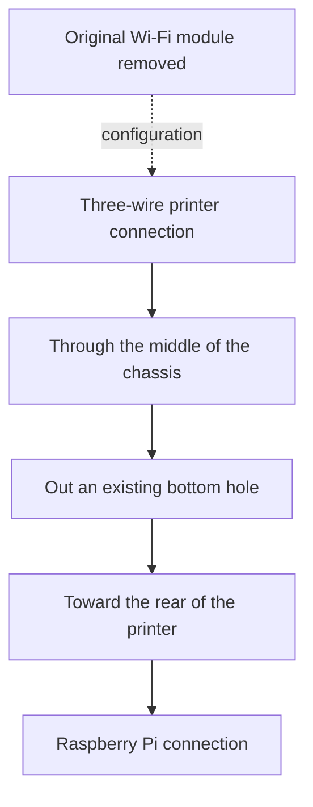

# Firmware prerequisite and physical modification

## Supported starting point before flashing the mod

This modification was developed for the **original Anycubic Photon Mono X running stock main firmware V3.5.4**. It is not a universal firmware upgrade and has not been validated for the Mono X 6K, other printer models, other main-firmware versions, or all board revisions.

The recorded printer information screen showed **V3.5.4** and **UI_V1.2** before the modification. UI_V1.2 is an observed interface version, not an independently established compatibility requirement. The displayed version string alone cannot prove the installed binary matches our reference.

The exact reference main image is `P_MXV5_4_0812(1).bin` from the 3.5.4 package, **303492 bytes**, SHA256:

```text
86496c6500a29775bd46347b9ae3072c16efdccd219f5c57a2722cc43dd554c1
```

The documented retry-v2 candidate was built from that reference and has SHA256:

```text
647712723c46af7e77aca4a08c9eae6826795ecc72fdd358c7d38315d230f3c6
```

**Before using a future flashing guide, establish a working stock V3.5.4 baseline on the matching original Mono X hardware, verify the reference image hash, and retain the original main image for rollback.** If starting from another version or uncertain hardware, stop at compatibility identification rather than flashing this candidate as a shortcut to upgrade. Any stock-version upgrade is a separate manufacturer procedure, including its board-specific requirements; this guide does not claim that every older printer can jump directly to 3.5.4.

The mod changes the main STM32 firmware's UART discovery/retry behavior. It does **not** update the FPGA or change the displayed version string. For our existing, working 3.5.4 baseline, both FPGA images were left unchanged throughout the mod and rollback comparisons. Do not flash both FPGA alternatives or assume they are interchangeable. No vendor firmware binary or flashing automation is distributed with this documentation.

Keep printer firmware work separate from Raspberry Pi imaging. A Pi image must never silently flash the printer. Perform firmware changes only while the printer is idle, with the stock rollback image and a recovery plan available. The v2 USB and delayed-handshake observations are recorded in [the test matrix](TEST_RESULTS.md); complete-print/control validation is still pending.

## What was physically changed on this printer

The **original Wi-Fi module was removed**. This setup does not leave that module installed alongside the Pi connection.

The owner routed **three wires through the middle of the printer chassis**, then **out through one of the existing holes on the bottom**, and **toward the back of the printer** for the Pi connection. An existing opening was used; no new drilled opening was reported.



This diagram records the **physical cable route**, not a pinout. Wire colors, connector orientation, exact signal-to-pin mapping and electrical levels must be checked against the actual hardware photos before publishing step-by-step electrical connection instructions. Do not infer a power connection from the count of three wires.

Hardware photos for the finished guide should identify the removed module location, the three-wire connection, the central chassis route, the existing bottom exit hole and the path to the rear. Add wire support and edge protection where appropriate, and keep the route clear of moving mechanisms and pinching when covers are installed. Power off and disconnect supplies before working inside the printer.
