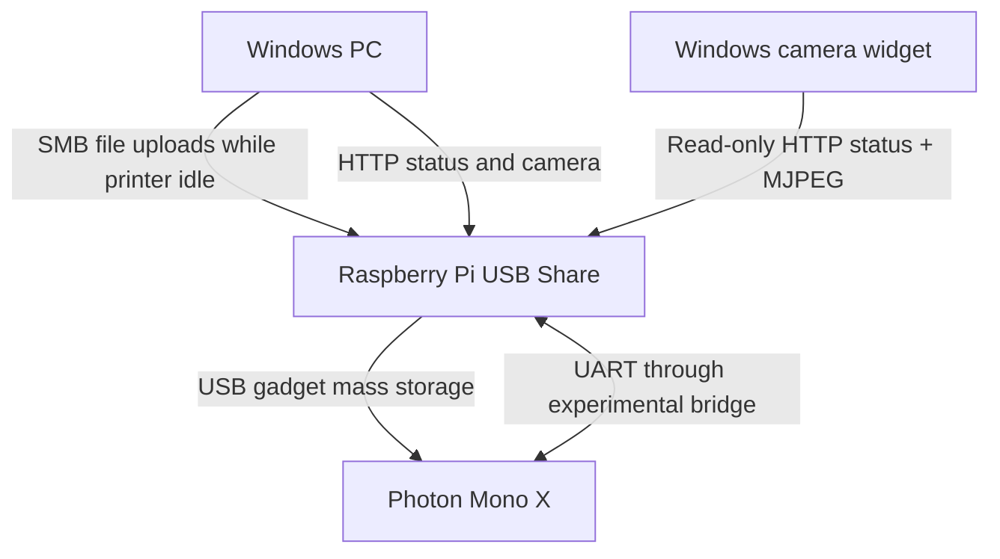

# Mono X USB Share continuation guide

Status: documentation and software fixes; image release not built. Tested observations concern an original Photon Mono X, not the Mono X 6K or every printer/Pi combination.

## Read before modifying the printer

The supported development baseline is **stock V3.5.4 on the original Photon Mono X**, using the exact reference main image identified in [firmware prerequisites and hardware routing](FIRMWARE_AND_HARDWARE.md). This is a version-specific main-firmware modification, not a generic upgrade. The observed UI version was UI_V1.2; compatibility beyond that tested setup is unproven.

In the owner's hardware setup, the **original Wi-Fi module was removed**. **Three wires run through the middle of the chassis, out an existing hole on the bottom, and toward the rear of the printer.** See the physical route diagram and the distinction between verified routing and pending pin-by-pin photo verification in the hardware guide.

## What connects to what



This is a logical diagram. Physical UART pin assignments, voltage levels and cable routing still require confirmed hardware photos before a wiring guide is published. Do not infer header pins from this diagram.

## Webpage remaining-time fix

The original page converted a duration to a JavaScript Date and sliced its time-of-day. This discarded whole days: 148817 seconds displayed 17:20:17 rather than 41:20:17. Both webpage source copies now use total-hours arithmetic. The separate installer is for existing installations.

Copy tools/fix_remaining_time.py to the Pi, then run:

```sh
sudo python3 fix_remaining_time.py --check
sudo python3 fix_remaining_time.py
```

Default page: `/home/pi/usb_share/html_root/anycubic_mono.php`. Use `--file /actual/path` for other layouts. The installer validates expected content, makes a timestamped backup and replaces the page atomically. It prints a rollback command. Refresh the browser; no reboot or service restart is needed. The display fix does not make the printer's estimate more accurate.

## Camera widget

See [Windows setup](../desktop/mono-x-widget/README.md). Use the Pi's hostname or IP address. The overlay displays the active job, progress, layers, remaining time, resin estimate and status freshness. It is read-only and does not start, pause or stop jobs.

## Print workflow

Finish file transfers while idle. Verify transferred files before starting a print. Do not change SMB storage while the printer is reading a job: the historical virtual-USB refresh can interrupt that access. Read-only monitoring is separate from file transfer. No printer controls are exercised by the widget.

## UART and USB recovery

Read [the investigation](UART_JOURNEY.md) and [the validation matrix](TEST_RESULTS.md). Firmware work remains experimental. It is not an automatic installation step and the Pi image must not silently flash a printer.

## Troubleshooting

- Time differs by exactly 24 hours: refresh the corrected webpage and compare the raw seconds_remaining value with total hours.
- Camera offline: check the existing camera page and port-8080 feed; the widget labels stale video and retries.
- Status offline: compare the existing printer webpage and API. Do not restart working services during an active print just to test recovery.
- USB files disappear after reboot: capture the UDC state and bridge logs while idle; distinguish the original baseline, v1 regression and v2 results.

## Photos and illustrated instructions

Annotated hardware photos and verified pin-by-pin wiring are pending. The current guide deliberately provides no unverified wiring diagram. Screenshots and photos will be reviewed for private data before publication.
